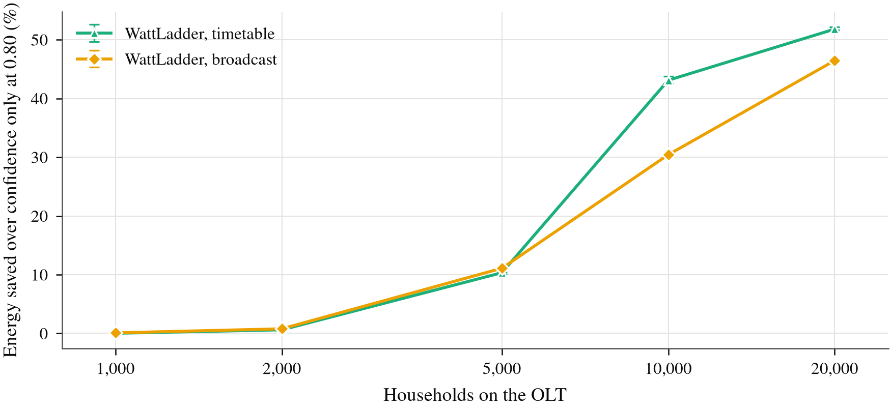

# WattLadder

**Energy-aware recursive offloading for LLM inference over passive optical networks.**


Undergraduate thesis in Computer Science at UFRGS, advised by Prof. Dr. Gabriel Luca Nazar
and co-advised by Prof. Dr. Dennis Giovani Balreira.

In recursive tiered inference, a query climbs from the user's device toward larger models
and each tier either answers it or passes it up, usually based only on how confident the
answer is. WattLadder also weighs energy at every tier: a server that batches queries
answers one more at little extra cost while it is busy, so going up can be cheaper than
answering below. At the same accuracy, it uses about half the energy once the server
serves 20,000 households.

<p align="center">
  
</p>

## Case study

Three tiers along a fibre access network, each running a larger model than the one below:

```
phone (Llama-3.2 1B) ──> ONU (Qwen2.5 1.5B) ──> OLT (Qwen2.5 7B, batched GPU)
       ▲                        ▲                         │
       └────────────────────────┴── the OLT's current cost per query
```

The tiers learn the OLT's cost in one of two ways:

| Strategy | Where the cost comes from |
|---|---|
| **Timetable** (`static_hour`) | one rate per hour of the day, learned in advance |
| **Broadcast** (`broadcast`) | the OLT reports its recent cost on the PON every 10 s |

They are compared with confidence-only escalation (`recserve`, Wu et al.), the same
escalation without the ONU (`recserve_no_onu`), a broadcast heard only on each
household's own answers (`piggyback`), and each tier answering alone (`*_alone`).

The OLT's energy curve was measured on an NVIDIA L4. Every tier's answers to GSM8K were
recorded once, so the simulator replays them instead of running the models. Household
traffic follows WildChat conversations in local time, with load drift taken from
BurstGPT.

## Quick start

```bash
cd implementation
python3 -m venv .venv && .venv/bin/pip install -r requirements.txt
.venv/bin/python -m pytest

# one run: 10,000 households, three policies
.venv/bin/python src/simulate/simulate.py --config config/study.yaml \
    --subscribers 10000 --policies recserve,static_hour,broadcast
```

Every setting is documented in `config/simulation.yaml` and can be overridden by a flag of
the same name. One-off runs write to `results/adhoc/`.

## Reproducing the study

```bash
bash src/simulate/run_study.sh 8                  # all scenarios, 8 parallel jobs
.venv/bin/python src/analyze/summarize_study.py   # -> results/study/SUMMARY.md
.venv/bin/python src/analyze/plot_study.py        # -> results/study/figures/
```

The 20,000-household runs take a few hours each on a laptop. `run_study_modal.py` runs
them on [Modal](https://modal.com) instead.

The GPU measurements are already in `results/measurements/`. To redo them on Modal:

```bash
modal run src/measure/measure_gpu_energy_static.py      # the OLT's energy curve
modal run src/measure/collect_answers.py                # every tier's GSM8K answers
modal run src/measure/measure_gpu_energy_continuous.py  # checks the simulated batching
```

## Repository layout

```
implementation/
  config/            published energy figures, simulator and study settings
  data/              load traces derived from WildChat and BurstGPT
  src/measure/       GPU measurements on Modal
  src/energy/        the energy model of the three tiers
  src/simulate/      the simulator (simulate.py) and the study scripts
  src/analyze/       summary tables and figures
  tests/             pytest
  results/           every output, written by scripts and never by hand
thesis/latex/        the thesis (infufrgs class, synced with Overleaf)
thesis/slides/       the defense slides
energy_tests.md      methods, measurements and the sources of each figure
```

To build the thesis, run `latexmk -pdf tcc.tex` in `thesis/latex/`.

## Data

- **GSM8K**: Cobbe et al., *Training Verifiers to Solve Math Word Problems*, 2021.
- **WildChat-4.8M**: Zhao et al., *WildChat: 1M ChatGPT Interaction Logs in the Wild*,
  ICLR 2024.
- **BurstGPT**: Wang et al., *BurstGPT: A Real-world Workload Dataset to Optimize LLM
  Serving Systems*, KDD 2025 ([repo](https://github.com/HPMLL/BurstGPT), CC BY 4.0).

## License

[MIT](LICENSE) © 2026 Diego Hommerding Amorim
